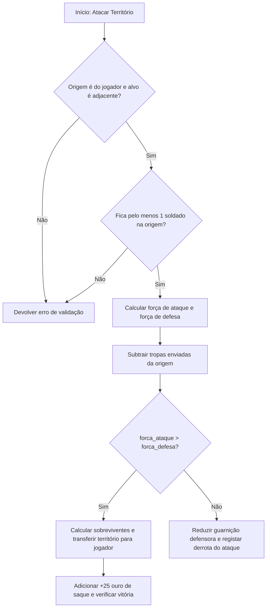
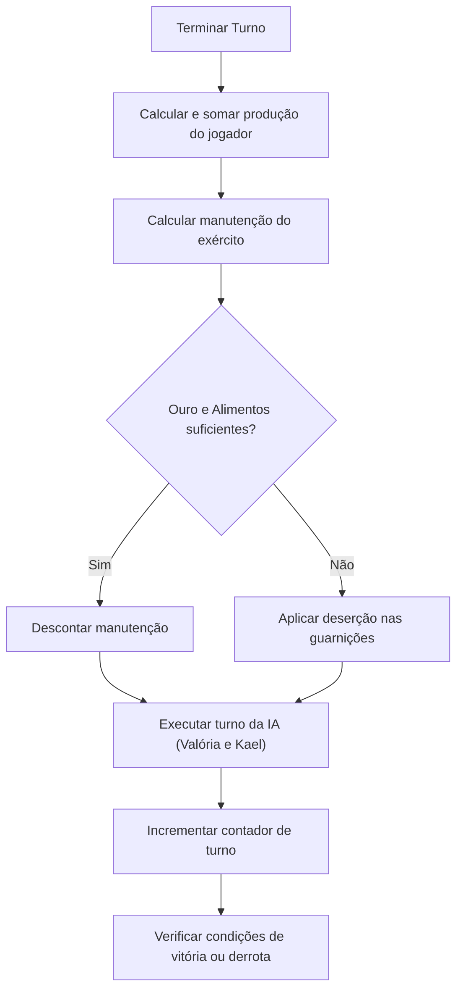

# Análise e Algoritmos — Projeto 01: Empire

## 1. Análise do Problema
O objetivo é modelar um jogo de estratégia territorial por turnos numa grelha de 5×5 territórios (25 regiões). Cada território possui proprietário, tipo de terreno, guarnição e produção base. O jogador toma decisões económicas e militares antes de passar o turno às facções controladas pelo computador.

### Dados de Entrada
- Seleção de território no mapa (`territorio_id` de 0 a 24).
- Ação escolhida: recrutar soldados (`quantidade`), mover tropas (`origem_id`, `destino_id`, `quantidade`), atacar (`origem_id`, `alvo_id`, `tropas_enviadas`), construir melhoria (`chave_melhoria`) ou investigar tecnologia (`chave_tech`).
- Comandos de ciclo de jogo: terminar turno, guardar ou carregar ficheiro JSON.

### Processamento
- Validação de adjacência ortogonal (`|linha1 - linha2| + |coluna1 - coluna2| == 1`) e de recursos disponíveis.
- Cálculo de produção líquida (soma dos territórios do jogador multiplicada pelos bónus de melhorias e tecnologias) e manutenção do exército.
- Resolução de combates comparando força ofensiva e força defensiva ponderada pelo terreno.
- Execução das ações da IA para cada facção adversária viva.
- Verificação das condições de vitória e derrota.

### Dados de Saída
- Mapa atualizado no `Canvas` com cores e guarnições.
- Painéis com recursos, produção/manutenção por turno, progresso de domínio e histórico de acontecimentos.
- Mensagens de resultado de combate, erro de validação ou fim de partida.

---

## 2. Algoritmos Principais e Pseudocódigo

### Algoritmo 1: Resolução de Combate (`atacar_territorio`)
```text
FUNÇÃO atacar_territorio(estado, origem_id, alvo_id, tropas_enviadas)
    SE estado_jogo != "em_curso" OU tropas_enviadas <= 0 ENTÃO
        DEVOLVER Falso, "Operação inválida"
    FIM SE
    origem <- obter_territorio(origem_id)
    alvo <- obter_territorio(alvo_id)
    SE origem.dono != "jogador" OU alvo.dono == "jogador" ENTÃO
        DEVOLVER Falso, "Alvo ou origem inválidos"
    FIM SE
    SE NÃO sao_adjacentes(origem, alvo) OU origem.guarnicao - tropas_enviadas < 1 ENTÃO
        DEVOLVER Falso, "Restrição geográfica ou guarnição mínima violada"
    FIM SE

    fator_ataque <- calcular_fator_ataque_jogador(estado)
    sorte <- aleatorio_entre(0.90, 1.15)
    forca_ataque <- tropas_enviadas * fator_ataque * sorte
    forca_defesa <- alvo.guarnicao * defesa_terreno_efetiva(alvo, estado)

    origem.guarnicao <- origem.guarnicao - tropas_enviadas

    SE forca_ataque > forca_defesa ENTÃO
        perdas <- minimo(0.85, (forca_defesa / forca_ataque) * 0.65)
        sobreviventes <- maximo(1, arredondar(tropas_enviadas * (1 - perdas)))
        alvo.dono <- "jogador"
        alvo.guarnicao <- sobreviventes
        estado.recursos.ouro <- estado.recursos.ouro + 25
        verificar_fim_de_jogo(estado)
        DEVOLVER Verdadeiro, "Vitória"
    SENÃO
        dano_def <- minimo(0.80, (forca_ataque / forca_defesa) * 0.60)
        alvo.guarnicao <- maximo(1, alvo.guarnicao - arredondar(alvo.guarnicao * dano_def))
        DEVOLVER Falso, "Ataque repelido"
    FIM SE
FIM FUNÇÃO
```

### Algoritmo 2: Fim de Turno (`terminar_turno`)
```text
FUNÇÃO terminar_turno(estado)
    producao <- calcular_producao_turno(estado)
    PARA cada recurso EM producao FAÇA
        estado.recursos[recurso] <- estado.recursos[recurso] + producao[recurso]
    FIM PARA

    manutencao <- calcular_manutencao_turno(estado)
    SE ouro >= manutencao.ouro E alimentos >= manutencao.alimentos ENTÃO
        subtrair manutencao de estado.recursos
    SENÃO
        zerar recurso em falta
        aplicar deserção de 20% das guarnições do jogador (mínimo 1 restante)
    FIM SE

    PARA cada faccao_ia EM ["inimigo_1", "inimigo_2"] FAÇA
        executar_turno_ia(estado, faccao_ia)
    FIM PARA

    estado.turno <- estado.turno + 1
    verificar_fim_de_jogo(estado)
FIM FUNÇÃO
```

---

## 3. Fluxogramas (Mermaid)

### Fluxograma do Combate


### Fluxograma do Fim de Turno

