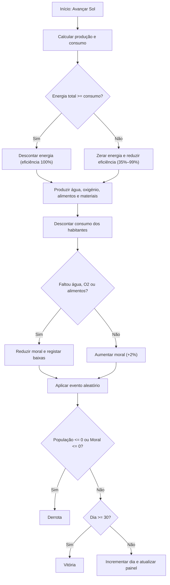

# Análise e Algoritmos — Projeto 02: Colónia Marciana

## 1. Análise do Problema
A simulação modela uma colónia humana em Marte durante 30 dias marcianos (Sols). A cada dia, as infraestruturas consomem energia para produzir água, oxigénio, alimentos e materiais, enquanto os habitantes consomem água, oxigénio e alimentos.

### Dados de Entrada
- Ações do jogador: construir estrutura, melhorar estrutura, acolher colonos, avançar dia, guardar ou carregar.
- Estado atual: recursos, estruturas (quantidade e nível), população, moral e duração de tempestades.

### Processamento
- Cálculo do balanço diário de produção e consumo (`calcular_balanco_previsto`).
- Verificação de disponibilidade energética e redução proporcional de eficiência em caso de défice.
- Aplicação do consumo populacional e penalização de moral/população em caso de escassez.
- Sorteio e aplicação de eventos aleatórios.
- Avaliação dos critérios de vitória (Sol 30 concluído) ou derrota (`populacao <= 0` ou `moral <= 0`).

### Dados de Saída
- Barras de progresso e previsão de saldo por Sol.
- Desenho atualizado da base em `Canvas` (incluindo aviso de tempestade de poeira).
- Relatório diário detalhado e resumo estatístico no fim da missão.

---

## 2. Algoritmos Principais e Pseudocódigo

### Algoritmo 1: Balanço Diário (`calcular_balanco_previsto`)
```text
FUNÇÃO calcular_balanco_previsto(estado)
    fator_solar <- 0.60 SE dias_tempestade > 0 SENÃO 1.0
    PARA cada chave, dados EM estado.estruturas FAÇA
        multiplicador <- dados.quantidade * (1 + 0.35 * (dados.nivel - 1))
        SE espec.energia_produzida > 0 ENTÃO
            producao.energia <- producao.energia + arredondar(espec.energia_produzida * multiplicador * fator_solar)
        FIM SE
        consumo.energia <- consumo.energia + arredondar(espec.energia_consumida * dados.quantidade * (1 + 0.15 * (dados.nivel - 1)))
        PARA cada recurso, valor EM espec.producao FAÇA
            producao[recurso] <- producao[recurso] + arredondar(valor * multiplicador)
        FIM PARA
    FIM PARA
    PARA cada recurso, taxa EM CONSUMO_POR_HABITANTE FAÇA
        consumo[recurso] <- consumo[recurso] + estado.populacao * taxa
    FIM PARA
    DEVOLVER producao, consumo
FIM FUNÇÃO
```

### Algoritmo 2: Ciclo Diário (`avancar_dia`)
```text
FUNÇÃO avancar_dia(estado)
    producao, consumo <- calcular_balanco_previsto(estado)
    energia_disp <- estado.recursos.energia + producao.energia
    SE energia_disp >= consumo.energia ENTÃO
        estado.recursos.energia <- minimo(limite_energia, energia_disp - consumo.energia)
        eficiencia <- 1.0
    SENÃO
        estado.recursos.energia <- 0
        eficiencia <- maximo(0.35, energia_disp / consumo.energia)
    FIM SE

    PARA cada rec EM [agua, oxigenio, alimentos, materiais] FAÇA
        adicionar arredondar(producao[rec] * eficiencia) até ao limite
    FIM PARA

    escassez <- lista vazia
    PARA cada rec EM [agua, oxigenio, alimentos] FAÇA
        SE estado.recursos[rec] >= consumo[rec] ENTÃO
            subtrair consumo[rec]
        SENÃO
            estado.recursos[rec] <- 0
            adicionar rec a escassez
        FIM SE
    FIM PARA

    SE escassez não está vazia ENTÃO
        reduzir moral e aplicar baixas na população
    SENÃO
        aumentar moral em +2 (máximo 100)
    FIM SE

    aplicar evento aleatório opcional
    verificar vitória (dia >= 30) ou derrota (populacao <= 0 ou moral <= 0)
FIM FUNÇÃO
```

---

## 3. Fluxograma do Ciclo Diário (Mermaid)

