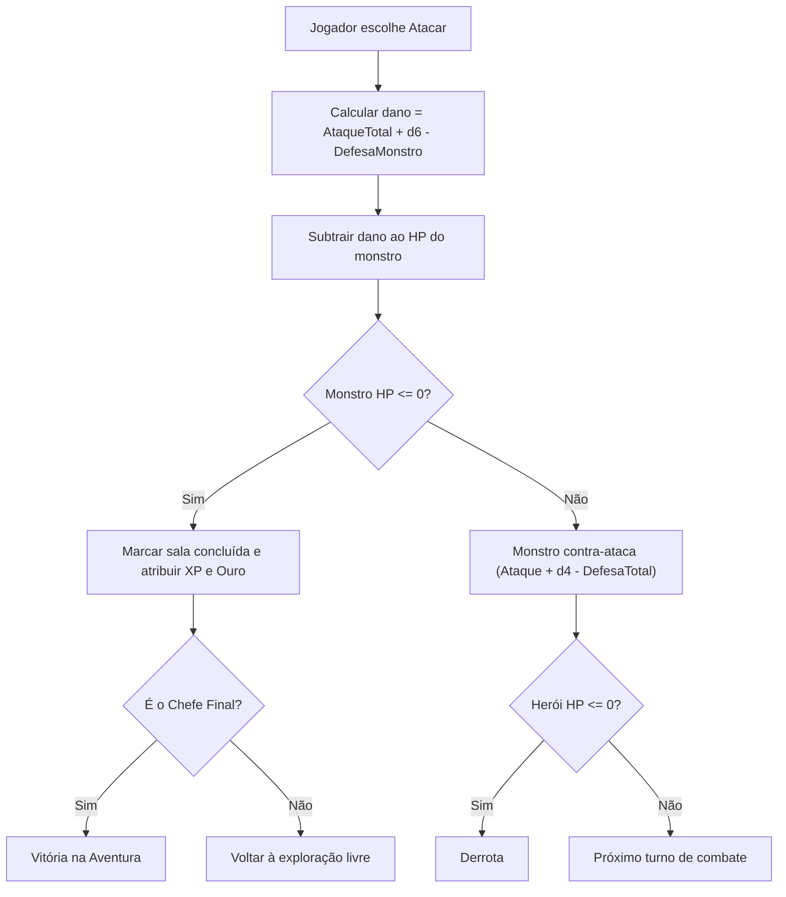

# Análise e Algoritmos — Projeto 03: Dungeon Quest

## 1. Análise do Problema
O jogo simula uma exploração de masmorra numa grelha 5×5 (25 salas). O estado varia entre exploração livre e combate por turnos. O jogador evolui a personagem derrotando inimigos e equipando itens até enfrentar o chefe final.

### Dados de Entrada
- Direção do movimento (`Norte`, `Sul`, `Este`, `Oeste`).
- Ação de combate (`Atacar`, `Defender`, `Fugir`).
- Seleção de item do inventário (`indice_item`).

### Processamento
- Validação dos limites da grelha e bloqueio de movimento durante combates.
- Cálculo de dano com rolagem aleatória de dados (`random.randint(1, 6)` para o herói e `1..4` para o monstro).
- Gestão de experiência e subida automática de nível com loop `while xp >= xp_proximo`.
- Troca segura de armas/armaduras no inventário.

### Dados de Saída
- Grelha da masmorra desenhada no `Canvas` com salas descobertas e posição do herói.
- Barras de HP e XP, atributos totais e registo cronológico de acontecimentos.

---

## 2. Algoritmos Principais e Pseudocódigo

### Algoritmo 1: Movimento e Descoberta de Sala (`mover_heroi`)
```text
FUNÇÃO mover_heroi(estado, d_linha, d_coluna)
    SE estado_jogo != "em_curso" OU em_combate ENTÃO
        DEVOLVER Falso, "Movimento bloqueado"
    FIM SE
    nova_lin <- posicao.linha + d_linha
    nova_col <- posicao.coluna + d_coluna
    sala <- obter_sala(nova_lin, nova_col)
    SE sala == Nulo ENTÃO
        DEVOLVER Falso, "Parede sólida"
    FIM SE
    posicao_anterior <- posicao
    posicao <- [nova_lin, nova_col]
    sala.visitada <- Verdadeiro
    SE sala.monstro != Nulo E NÃO sala.concluida ENTÃO
        em_combate <- Verdadeiro
    SENÃO SE sala.tipo == "tesouro" E NÃO sala.concluida ENTÃO
        adicionar sala.tesouro ao inventario; sala.concluida <- Verdadeiro
    SENÃO SE sala.tipo == "fonte" E NÃO sala.concluida ENTÃO
        recuperar até 15 HP; sala.concluida <- Verdadeiro
    FIM SE
    DEVOLVER Verdadeiro
FIM FUNÇÃO
```

### Algoritmo 2: Turno de Combate (`executar_ataque_combate`)
```text
FUNÇÃO executar_ataque_combate(estado)
    dano <- maximo(1, ataque_total(estado) + dado(1, 6) - monstro.defesa)
    monstro.hp <- maximo(0, monstro.hp - dano)
    SE monstro.hp <= 0 ENTÃO
        sala.concluida <- Verdadeiro
        em_combate <- Falso
        heroi.ouro <- heroi.ouro + monstro.ouro
        adicionar_xp(estado, monstro.xp)
        SE monstro.chefe ENTÃO
            estado_jogo <- "vitoria"
        FIM SE
    SENÃO
        contra_ataque_monstro(estado, monstro)
    FIM SE
FIM FUNÇÃO
```

---

## 3. Fluxograma do Combate (Mermaid)

