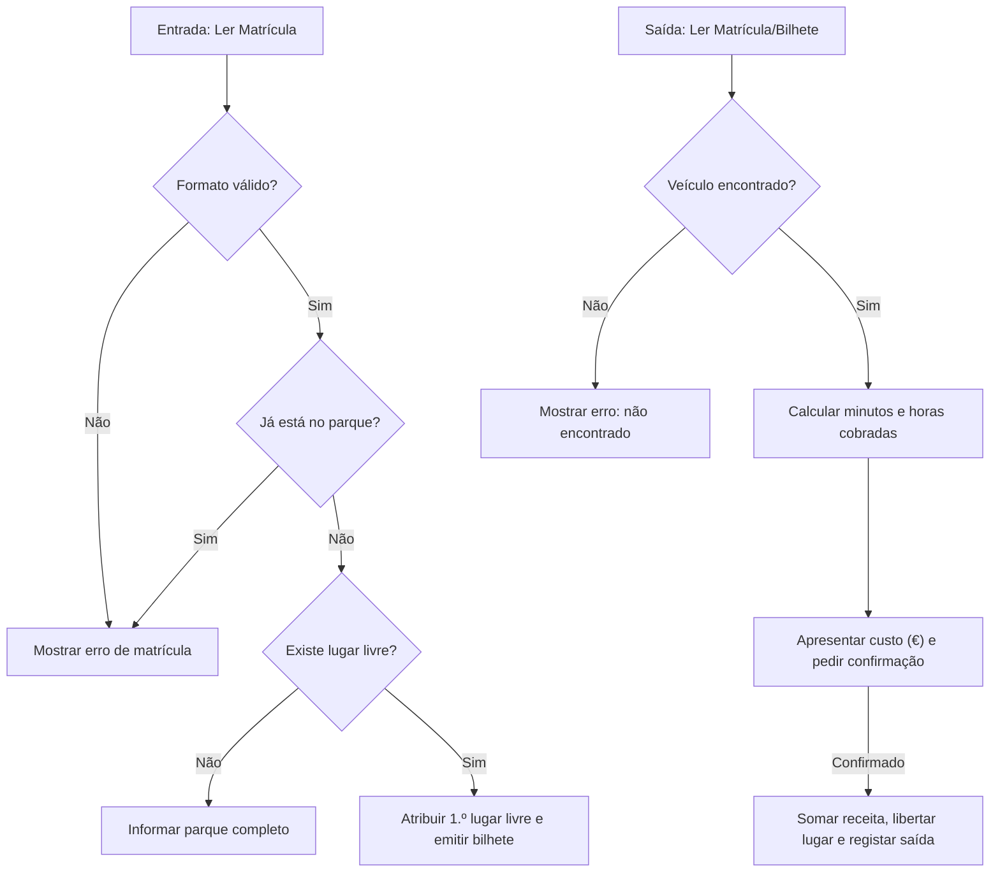

# Análise e Algoritmos — Projeto 04: Parque de Estacionamento

## 1. Análise do Problema
O simulador controla os lugares de um parque de estacionamento, gerindo entradas, saídas, tarifação em euros, relógio próprio de simulação e estatísticas operacionais.

### Dados de Entrada
- Matrícula na entrada (`str`).
- Matrícula ou número de bilhete na saída (`str`).
- Intervalo de avanço do relógio em minutos (`int`).
- Configurações de tarifa por hora (`float`) e capacidade (`int`).

### Processamento
- Validação com expressão regular (`PADRAO_MATRICULA`) e verificação de duplicados.
- Procura sequencial do primeiro lugar livre (`ocupado == False`).
- Cálculo da diferença temporal (`saida_dt - entrada_dt`) e arredondamento por excesso à hora iniciada (`math.ceil(minutos / 60)`).
- Atualização de estatísticas (receita total, taxa de ocupação, tempo médio).

### Dados de Saída
- Planta visual do parque no `Canvas` com veículos desenhados.
- Tabela de veículos estacionados e histórico cronológico.
- Diálogo de confirmação com resumo de permanência e valor em euros (€).

---

## 2. Algoritmos Principais e Pseudocódigo

### Algoritmo 1: Entrada de Veículo (`registar_entrada`)
```text
FUNÇÃO registar_entrada(estado, matricula)
    valida, mat_norm <- normalizar_e_validar_matricula(matricula)
    SE NÃO valida ENTÃO
        DEVOLVER Falso, "Matrícula inválida"
    FIM SE
    SE encontrar_veiculo(estado, mat_norm) != Nulo ENTÃO
        DEVOLVER Falso, "Veículo já estacionado"
    FIM SE
    lugar <- primeiro lugar com ocupado == Falso
    SE lugar == Nulo ENTÃO
        DEVOLVER Falso, "Parque completo"
    FIM SE
    bilhete <- formatar("BIL-", estado.proximo_bilhete)
    estado.proximo_bilhete <- estado.proximo_bilhete + 1
    lugar.ocupado <- Verdadeiro
    lugar.veiculo <- {mat_norm, bilhete, estado.relogio}
    estado.total_entradas <- estado.total_entradas + 1
    DEVOLVER Verdadeiro, bilhete
FIM FUNÇÃO
```

### Algoritmo 2: Cálculo de Tarifa (`calcular_custo_permanencia`)
```text
FUNÇÃO calcular_custo_permanencia(entrada_iso, saida_dt, tarifa_hora)
    entrada_dt <- converter_iso(entrada_iso)
    segundos <- maximo(0, diferenca_em_segundos(saida_dt, entrada_dt))
    minutos <- segundos DIV 60
    SE minutos == 0 ENTÃO
        horas_cobradas <- 1
    SENÃO
        horas_cobradas <- teto(minutos / 60)
    FIM SE
    valor <- arredondar(horas_cobradas * tarifa_hora, 2)
    DEVOLVER minutos, horas_cobradas, valor
FIM FUNÇÃO
```

---

## 3. Fluxograma de Entrada e Saída (Mermaid)

