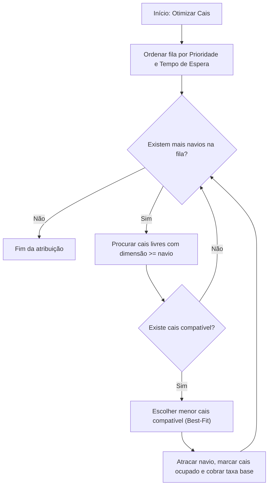

# Análise e Algoritmos — Projeto 05: Porto Marítimo

## 1. Análise do Problema
O simulador modela um terminal portuário com 4 cais de capacidades diferentes, fila de espera prioritária de navios, inventário de contentores no pátio e balanço financeiro em euros.

### Dados de Entrada
- Registo de navios: nome, dimensão, número de contentores, operação (`Descarga`/`Carga`), prioridade e tipo de carga.
- Comandos: atracar manualmente, otimizar cais, executar ciclo portuário, adicionar/expedir contentores.

### Processamento
- Ordenação da fila de espera por prioridade decrescente, espera acumulada decrescente e ordem de chegada.
- Algoritmo de atribuição otimizada (*best-fit*): para cada navio na fila ordenada, escolhe o menor cais livre cuja capacidade suporte a dimensão do navio.
- Movimentação de contentores em cada ciclo consoante o número de gruas do cais (`gruas * MOVIMENTACAO_POR_GRUA`).
- Cálculo de receitas, custos operacionais, custos de armazém e custos de espera.

### Dados de Saída
- Representação gráfica no `Canvas` com cais, gruas, navios e contentores.
- Tabelas da fila de espera, cais e inventário de contentores.
- Indicadores de lucro (€), taxa de utilização (%) e tempo médio de espera.

---

## 2. Algoritmos Principais e Pseudocódigo

### Algoritmo 1: Atribuição Otimizada de Cais (`atribuir_cais_otimizado`)
```text
FUNÇÃO atribuir_cais_otimizado(estado)
    fila <- ordenar navios em fila por (-prioridade, -ciclos_espera, ciclo_chegada)
    PARA cada navio EM fila FAÇA
        candidatos <- cais livres ONDE dimensao(cais) >= dimensao(navio)
        SE candidatos não está vazia ENTÃO
            melhor_cais <- minimo de candidatos por (dimensao(cais), -gruas)
            atracar_navio(estado, navio.id, melhor_cais.id)
        FIM SE
    FIM PARA
FIM FUNÇÃO
```

### Algoritmo 2: Ciclo Operacional (`executar_ciclo_portuario`)
```text
FUNÇÃO executar_ciclo_portuario(estado)
    PARA cada cais EM estado.cais FAÇA
        SE cais.ocupado ENTÃO
            cais.ciclos_ocupado <- cais.ciclos_ocupado + 1
            somar custo operacional do cais
            navio <- obter_navio(cais.navio_id)
            movidos <- minimo(cais.gruas * 2, navio.contentores_restantes)
            processar descarga (criar contentores) ou carga (retirar do pátio)
            navio.contentores_restantes <- navio.contentores_restantes - movidos
            somar receita dos contentores movidos
            SE navio.contentores_restantes <= 0 ENTÃO
                marcar navio como "Concluído" e libertar cais
            FIM SE
        FIM SE
    FIM PARA
    somar custos de armazenamento dos contentores no pátio
    incrementar ciclos_espera e somar custo de espera aos navios em fila
    atualizar finanças e avançar contador de ciclo
FIM FUNÇÃO
```

---

## 3. Fluxograma da Otimização de Cais (Mermaid)

