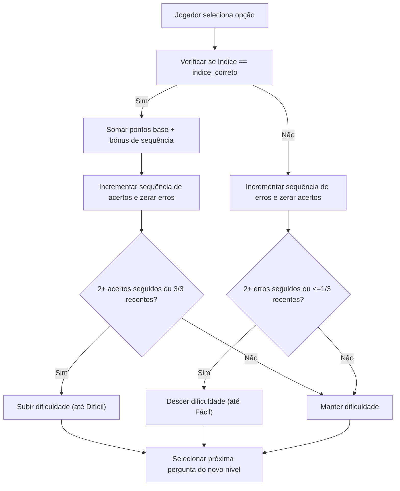

# Análise e Algoritmos — Projeto 06: Quiz Adaptativo Romeu e Julieta

## 1. Análise do Problema
O sistema apresenta rondas de 10 perguntas de escolha múltipla sobre *Romeu e Julieta*, ajustando automaticamente a dificuldade consoante o desempenho recente e as sequências de acertos/erros do utilizador.

### Dados de Entrada
- Nome do jogador (`str`).
- Índice da opção selecionada (`0` a `3`).

### Processamento
- Seleção de pergunta não repetida (`id not in ids_usadas`) compatível com `dificuldade_atual`.
- Avaliação da resposta e cálculo de pontuação (`base + bonus_sequencia`).
- Atualização de `sequencia_acertos`, `sequencia_erros` e `desempenho_recente`.
- Adaptação da dificuldade (`_adaptar_dificuldade`) e gravação da classificação final ordenada.

### Dados de Saída
- Ecrã de pergunta com categoria, nível atual, barra de progresso e 4 botões coloridos.
- Cartão de feedback imediato com explicação literária.
- Quadro de classificações ordenado por pontuação decrescente.

---

## 2. Algoritmos Principais e Pseudocódigo

### Algoritmo 1: Adaptação de Dificuldade (`_adaptar_dificuldade`)
```text
FUNÇÃO adaptar_dificuldade(estado)
    idx <- indice de estado.dificuldade_atual em ["Fácil", "Média", "Difícil"]
    recente <- últimas 3 respostas de estado.desempenho_recente
    SE estado.sequencia_acertos >= 2 OU (tamanho(recente) == 3 E soma(recente) == 3) ENTÃO
        SE idx < 2 ENTÃO
            estado.dificuldade_atual <- NIVEIS[idx + 1]
            estado.sequencia_acertos <- 0
        FIM SE
    SENÃO SE estado.sequencia_erros >= 2 OU (tamanho(recente) == 3 E soma(recente) <= 1 E NÃO recente[-1]) ENTÃO
        SE idx > 0 ENTÃO
            estado.dificuldade_atual <- NIVEIS[idx - 1]
            estado.sequencia_erros <- 0
        FIM SE
    FIM SE
FIM FUNÇÃO
```

### Algoritmo 2: Seleção da Próxima Pergunta (`selecionar_proxima_pergunta`)
```text
FUNÇÃO selecionar_proxima_pergunta(estado)
    SE estado.perguntas_respondidas >= estado.total_perguntas ENTÃO
        estado.terminado <- Verdadeiro
        DEVOLVER Nulo
    FIM SE
    niveis_ordenados <- ordenar NIVEIS por distância absoluta ao nível atual
    PARA cada nivel EM niveis_ordenados FAÇA
        candidatas <- perguntas com dificuldade == nivel e id NÃO em ids_usadas
        SE candidatas não está vazia ENTÃO
            escolhida <- escolher aleatoriamente de candidatas
            estado.pergunta_atual <- escolhida
            DEVOLVER escolhida
        FIM SE
    FIM PARA
FIM FUNÇÃO
```

---

## 3. Fluxograma do Algoritmo Adaptativo (Mermaid)

