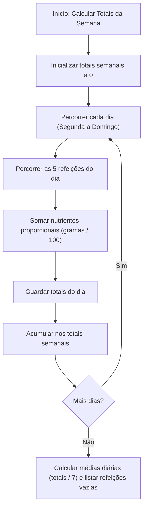

# Análise e Algoritmos — Projeto 07: Planeamento Alimentar Semanal

## 1. Análise do Problema
A aplicação organiza um plano semanal de 7 dias × 5 refeições (35 refeições no total) numa interface de consola estruturada, calculando calorias, proteínas, hidratos de carbono e gorduras proporcionalmente às quantidades em gramas introduzidas.

### Dados de Entrada
- Opção numérica de menu.
- Dia da semana, refeição, identificador do alimento e quantidade em gramas (`> 0`).
- Termo opcional de pesquisa de alimentos.

### Processamento
- Validação de intervalos, tipos numéricos e existência dos alimentos/dias/refeições.
- Cálculo proporcional dos nutrientes (`(gramas / 100.0) * valor_100g`).
- Agregação hierárquica: Alimento -> Refeição -> Dia -> Semana (totais e médias).
- Identificação de refeições vazias ao longo dos 7 dias.

### Dados de Saída
- Tabelas formatadas na consola com separadores, grelha semanal, barras ASCII de comparação diária e percentagens do prato nutricional.

---

## 2. Algoritmos Principais e Pseudocódigo

### Algoritmo 1: Cálculo Nutricional por Refeição e Dia
```text
FUNÇÃO calcular_totais_refeicao(plano, dia, refeicao)
    totais <- {calorias: 0, proteinas: 0, hidratos: 0, gorduras: 0}
    PARA cada entrada EM plano.dias[dia][refeicao] FAÇA
        alimento <- obter_alimento_por_id(entrada.alimento_id)
        SE alimento != Nulo ENTÃO
            fator <- entrada.gramas / 100.0
            PARA cada nutriente EM totais FAÇA
                totais[nutriente] <- arredondar(totais[nutriente] + alimento[nutriente] * fator, 1)
            FIM PARA
        FIM SE
    FIM PARA
    DEVOLVER totais
FIM FUNÇÃO
```

### Algoritmo 2: Identificação de Refeições Não Planeadas
```text
FUNÇÃO identificar_refeicoes_nao_planeadas(plano)
    vazias <- lista vazia
    PARA cada dia EM DIAS_SEMANA FAÇA
        PARA cada refeicao EM REFEICOES FAÇA
            SE tamanho(plano.dias[dia][refeicao]) == 0 ENTÃO
                adicionar (dia, refeicao) a vazias
            FIM SE
        FIM PARA
    FIM PARA
    DEVOLVER vazias
FIM FUNÇÃO
```

---

## 3. Fluxograma do Cálculo Semanal (Mermaid)

